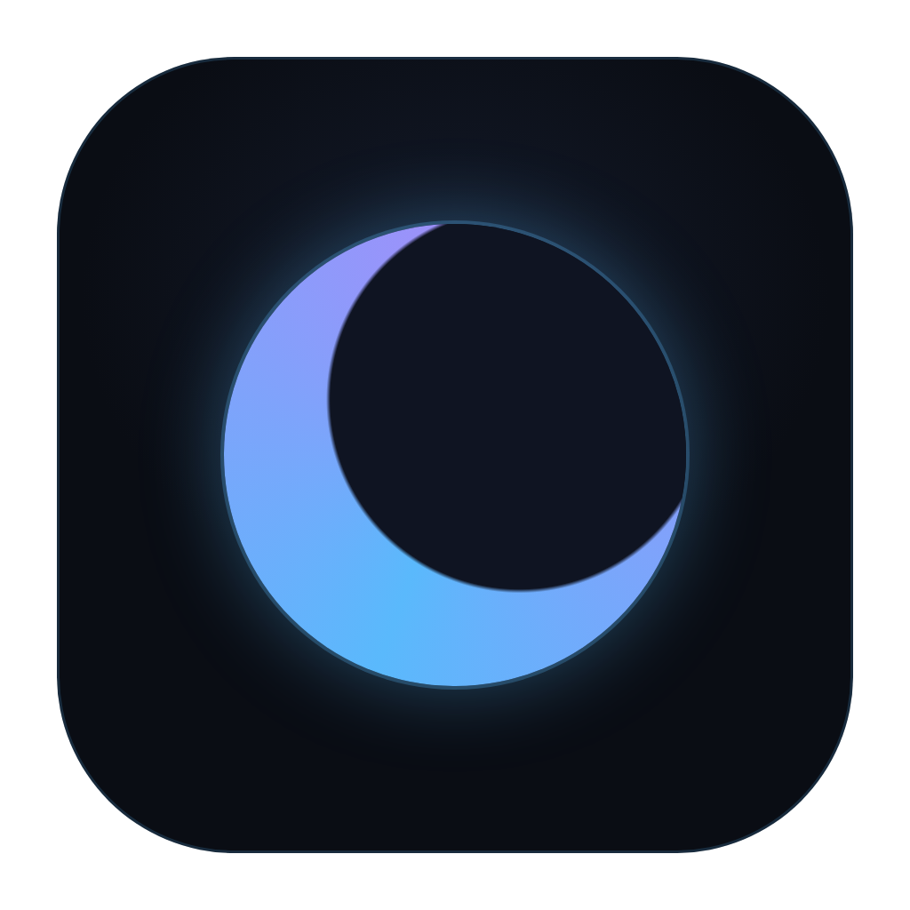
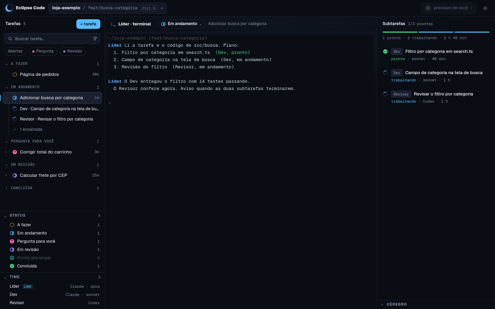
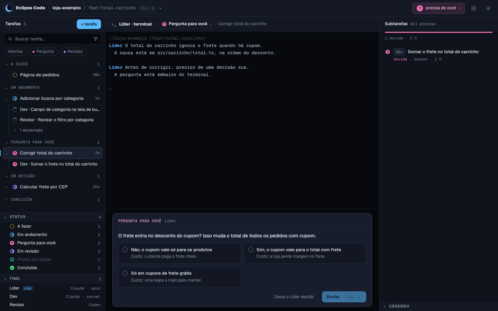
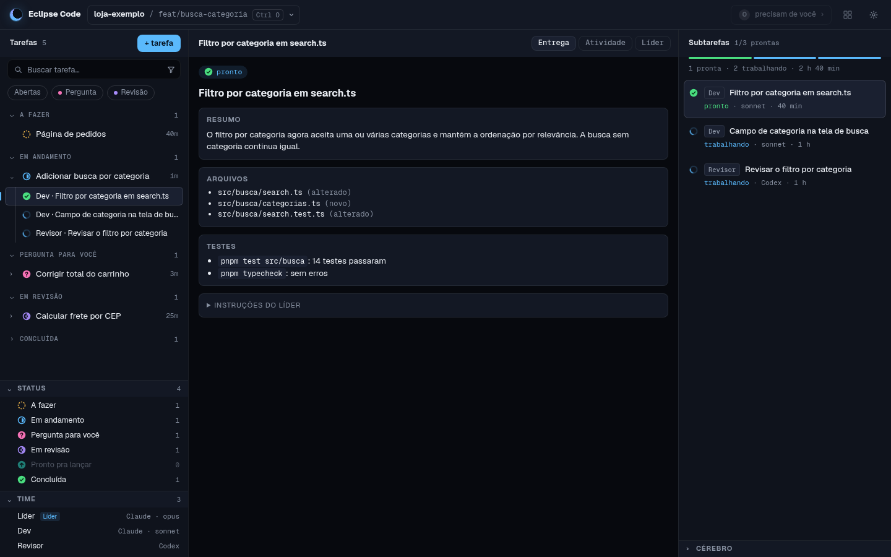
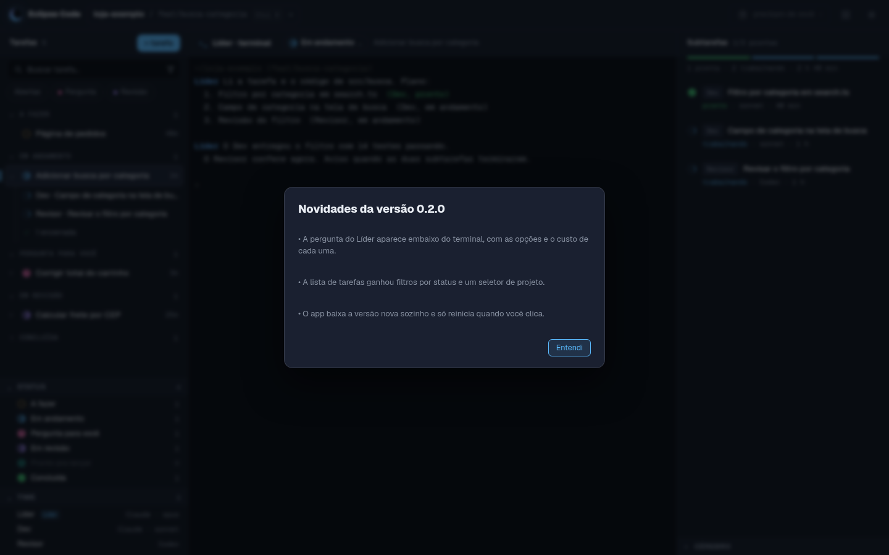
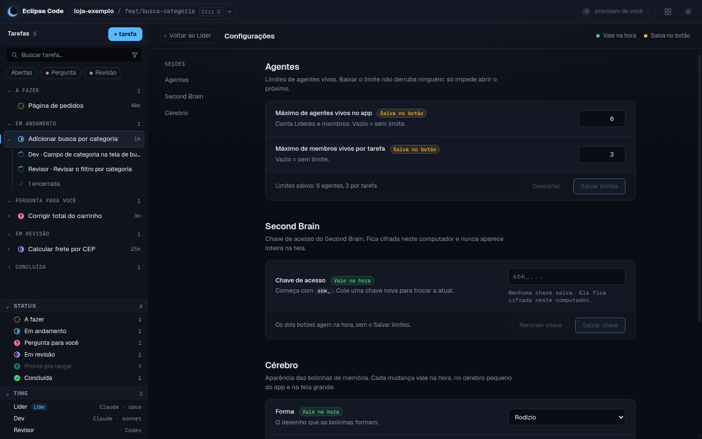

<p align="center">
  
</p>

<h1 align="center">Eclipse Code</h1>

<p align="center">
  Você escreve a tarefa. Um Líder divide o trabalho, um time de agentes faz, e você revisa.
</p>

<p align="center">
  <a href="../../releases/latest">Baixar</a> ·
  <a href="CHANGELOG.md">Novidades</a> ·
  <a href="LICENSE">Licença MIT</a>
</p>

<p align="center">
  
</p>

---

O Eclipse Code é um app de desktop para Linux que organiza trabalho com agentes de código
(Claude Code e Codex). Cada tarefa tem um **Líder** num terminal de verdade. O Líder lê o
código, faz perguntas quando só você pode decidir e abre **subtarefas** para membros do time,
como Dev e Revisor. No fim, ele faz o commit e manda a tarefa para a sua revisão.

## Índice

- [Como funciona](#como-funciona)
- [Instalar](#instalar)
- [Atualização automática](#atualização-automática)
- [Termos](#termos)
- [Desenvolver](#desenvolver)
- [Lançar versão](#lançar-versão)
- [Origem e licença](#origem-e-licença)

## Como funciona

1. **Você cria a tarefa** num projeto (uma pasta com git).
2. **O app cria uma worktree e uma branch** só para essa tarefa. O seu checkout principal não muda.
3. **O Líder abre num terminal** no meio da tela, com `claude` ou `codex`.
4. **O Líder divide o pedido em subtarefas.** Cada membro roda sem terminal, pelo ACP, e
   entrega um resumo, os arquivos mudados e os testes que rodou.
5. **Quando precisa de você, o Líder pergunta.** A pergunta aparece embaixo do terminal e no
   botão "precisa de você" do topo, com opções e o custo de cada uma.
6. **O Líder conclui.** Ele faz o commit na branch da tarefa, e a tarefa vai para "Em revisão".

A tarefa passa por 6 status. O app move sozinho os 4 primeiros. Só você marca os 2 últimos.

| Status             | Quem muda | Quando                       |
| ------------------ | --------- | ---------------------------- |
| A fazer            | App       | Ao criar a tarefa            |
| Em andamento       | App       | O Líder está trabalhando     |
| Pergunta para você | App       | Há uma pergunta sem resposta |
| Em revisão         | App       | O Líder concluiu             |
| Pronto pra lançar  | Você      | Você aprovou                 |
| Concluída          | Você      | Você lançou                  |

Também há:

- **Configurações**, com o limite de agentes ao mesmo tempo (no total e por tarefa).
- **Cérebro**, um plugin opcional que mostra a memória do
  second-brain como um grafo.

### Telas

**Pergunta do Líder.** A pergunta aparece embaixo do terminal, com as opções e o custo de cada uma.



**Entrega de uma subtarefa.** O membro entrega um resumo, os arquivos mudados e os testes que rodou.



**Novidades da versão.** Na primeira abertura depois de atualizar, o app mostra o que mudou.



**Configurações.** Aqui você define o limite de agentes ao mesmo tempo e a chave do Cérebro.



## Instalar

Requisitos:

- Linux x64.
- [Claude Code](https://docs.anthropic.com/en/docs/claude-code) e/ou
  [Codex](https://github.com/openai/codex) instalados e com login feito. O app usa o
  `claude` e o `codex` que estão no seu `PATH`.
- `git`.

Passos:

1. Baixe o `Eclipse-Code-x86_64.AppImage` em [Releases](../../releases/latest).
2. Dê permissão de execução:

   ```bash
   chmod +x Eclipse-Code-x86_64.AppImage
   ```

3. Abra o arquivo:

   ```bash
   ./Eclipse-Code-x86_64.AppImage
   ```

Os dados ficam em `~/.config/eclipse-code-next`: o banco SQLite e as worktrees das tarefas.

## Atualização automática

O app procura versão nova ao abrir e a cada 4 horas. Ele baixa sozinho e avisa no topo:
**"Versão X pronta · Fechar e instalar"**.

- O app **nunca reinicia sozinho**, porque fechar o app para os agentes em andamento.
- Se você não clicar, a versão nova entra quando você fechar o app.
- Na primeira abertura da versão nova, a janela **"Novidades da versão X"** mostra o que mudou.

A atualização automática só funciona no AppImage baixado do Releases.
Não renomeie o arquivo nem ponha uma versão no nome. Assim a versão nova entra no mesmo caminho, e atalhos e lançadores continuam funcionando.

## Termos

| Termo     | Significado                                                                    |
| --------- | ------------------------------------------------------------------------------ |
| Líder     | Agente que recebe a tarefa, planeja, pergunta, delega e faz o commit.          |
| Membro    | Agente de um papel do time (Dev, Revisor) que faz uma subtarefa.               |
| Subtarefa | Pedaço do trabalho com instruções e critério de pronto. Estado final não muda. |
| Worktree  | Cópia de trabalho do git, separada do checkout principal.                      |
| ACP       | Agent Client Protocol. O app fala com os membros por ele, sem terminal.        |
| MCP       | Model Context Protocol. O Líder usa as ferramentas do app por ele.             |

## Desenvolver

Stack: Electron 41, electron-vite, React 19, TypeScript estrito, xterm.js, node-pty,
better-sqlite3 e zod.

```bash
pnpm install     # instala e recompila os módulos nativos para o Electron
pnpm dev         # abre o app em modo de desenvolvimento
pnpm typecheck
pnpm lint
pnpm test        # vitest dentro do Electron; precisa de display
pnpm build
```

Estrutura:

| Pasta          | Conteúdo                                                                    |
| -------------- | --------------------------------------------------------------------------- |
| `src/main`     | Processo principal: tarefas no SQLite, ACP, Líder, MCP, terminal, worktree. |
| `src/renderer` | A tela, em React.                                                           |
| `src/shared`   | Contratos de IPC e regras de domínio, usados pelos dois lados.              |
| `src/preload`  | A ponte segura entre a tela e o main.                                       |
| `tests`        | Agentes falsos e fixtures. Os testes nunca usam um modelo real.             |

Regras do código:

- Só o processo principal escreve o estado. A tela lê e pede operações.
- Toda entrada de IPC passa por validação com zod.
- Uma subtarefa em estado final (pronta, bloqueada ou cancelada) nunca muda.
- Os textos da tela ficam em português, com acento.

## Lançar versão

1. Escreva a seção nova no `CHANGELOG.md`, no formato `## X.Y.Z - AAAA-MM-DD`. O app mostra
   esse texto ao usuário, então escreva para quem usa, não para quem programa.
2. Suba a versão no `package.json`.
3. Rode `pnpm test` no seu PC. O CI não roda os testes.
4. Faça o commit na `main`.
5. Crie e envie a tag:

   ```bash
   git tag vX.Y.Z && git push origin vX.Y.Z
   ```

O workflow [`release.yml`](.github/workflows/release.yml) confere se a tag bate com o
`package.json` e se o CHANGELOG tem a seção. Depois ele roda typecheck e lint, gera o AppImage
e publica o release com as notas. Leva uns 2 minutos.

## Origem e licença

O projeto nasceu como fork do OpenCove (MIT) e foi reescrito do zero, sem canvas.

Licença MIT. Veja [LICENSE](LICENSE).
